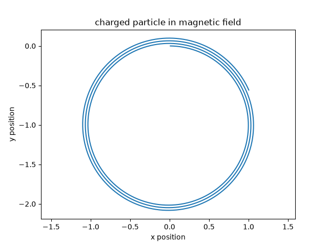
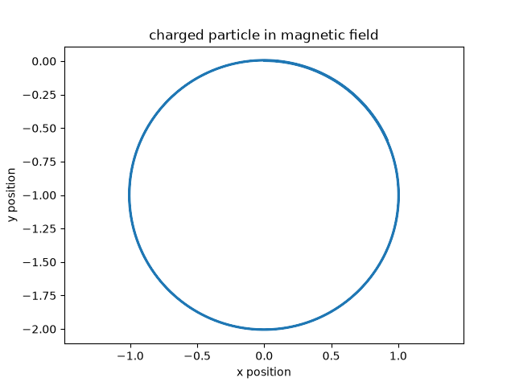

# Charged Particle in a Magnetic Field

A short Python simulation of a charged particle moving through a uniform magnetic field, using the Lorentz force F = q(v × B).

## What it does
Steps the particle forward in small time steps (Euler method) and plots its path. With q = m = B = v = 1, the expected path is a circle of radius r = mv/(qB) = 1.

## What I found
- The radius matched the expected value of 1.
- The path slowly spirals outward instead of closing, because the Euler method adds a small amount of energy each step.
- Shrinking the time step from 0.01 to 0.001 made the drift much smaller (compare the two plots).
- Next step: implement a method to reduce the drift to 0. 

